# Rebirth of Civilisation

**2034. Humanity destroys itself. The primates inherit the Earth.**

*Rebirth of Civilisation* is a free, open-source, turn-based 4X strategy game for Windows in the tradition of the classic *Civilization* games. It opens in 2032, as humanity drifts towards nuclear war. You lead a troop of chimpanzees, bonobos, orangutans, gorillas, baboons, capuchins, gibbons or snow monkeys: survive the Fall, evolve speech, settle down and rebuild civilisation from the ruins of the old world.


> An independent fan project, not affiliated with or endorsed by Firaxis Games, 2K or the *Civilization* franchise.

## Download and play

* **Download** `RebirthOfCivilisation-windows-x64.zip` from the [Releases](../../releases) page.
* **Install:** none. Unzip and run `RebirthOfCivilisation.exe` (Windows 7 to 11, 64-bit). Keep the `assets` folder next to it for music and sound.
* **Saves** go to `%APPDATA%\RebirthOfCivilisation`; the game also autosaves every 5 turns.
* **Privacy:** the game never connects to the internet and collects no data.
* **Code signing:** free code signing provided by [SignPath.io](https://about.signpath.io), certificate by [SignPath Foundation](https://signpath.org) (in progress - current downloads are unsigned, so Windows 11 Smart App Control may block them). See the [code signing policy](CODE_SIGNING_POLICY.md).

## A game in four ages

| Age | |
|---|---|
| **The last days** (2032 – 2034) | Your species is a wandering band. Human cities glow on the horizon and their radios grow more frightened each turn. Stay well clear of them. |
| **The Fall** (August 2034) | Nuclear war ends humanity. Every human city, base and power plant becomes a ruin ringed with fallout. |
| **The wandering age** | For tens of thousands of years the primates roam, forage and fight off predators while their brains evolve towards speech. Only a species with Speech and Cultivation can found its first city. |
| **The rebirth** (Year 1 *After the Fall* onwards) | From fire and stone tools to writing, currency, industry and computing - and the race to complete the Rebirth Project. |


## Features

### A world worth exploring
* Randomly generated hex maps in three sizes (4, 6 or 8 species), four map types - Continents, Pangaea, Archipelago and Fractal - and three sea levels.
* Navigable rivers: boats sail up and down them, river cities are inland ports, and waterfalls block the way.
* Lakes, floodplains, marshes, oases, reefs, volcanoes and eight natural wonders.
* Resources that appear only once your people understand them, each with its own icon and look on the map.
* The ruins of humanity, holding layers of scrap, books, machines and data that give up their secrets as your knowledge grows.

### A people that evolves
* **Eight playable primates**, each with its own strengths, a unique unit, a diplomatic personality and its own voice.
* **A nomadic beginning:** roaming bands forage, grow, split and send out war parties until they can settle.
* **Evolution:** four kinds of evolutionary pressure - social, ecological, conflict and mutation - drive a branching tree of traits, from the Enlarged Neocortex and Speech to strands such as Master Toolmakers, Apex Predators or Fallout-Adapted. Your species earns no science at all until its brain is ready.
* **Disasters** - wildfires, droughts, floods, epidemics, earthquakes, harsh winters, reactor leaks and predator migrations - that strike where you live and push evolution on.

### Building a civilisation
* 49 technologies across nine eras, from the Awakening to the Rebirth.
* Cities that grow, claim land, work tiles and build from 28 buildings and six world wonders.
* Gold only once your people discover Currency.
* **Happiness and luxuries:** crowded cities and war-weary peoples grow discontent; luxuries, buildings and festivals keep them content or celebrating.
* **Traditions** bought with culture.
* **Trade caravans** over land, rivers and sea, and roads that improve from worn tracks to tarmac.
* **Great Primates** - Thinkers, Artisans, Merchants, Storytellers and Warleaders - born of your people's deeds, or sponsored late in the game with gold or faith.

### Faith and its price
Shrines, Temples and Cathedrals produce Faith. Found a religion, choose its beliefs, and spread it with Missionaries and trade. Faith buys festivals and buildings, calls Great Primates - and, for a zealous enough people, buys soldiers of the faith. But a people devoted too heavily to its faith grows **zealous** and resists new ideas: high zeal costs science.

### War
* Over 30 unit types, from Warbands and Stone Throwers to Salvaged Rifles, Rebuilt Tanks and Exo-Primates.
* Experience and promotions for veteran units, and unit upgrades as your technology advances.
* Navies from dugout canoes to salvaged battleships, with transports and river gunboats.
* Feral packs and rogue war machines roaming the wastelands.
* Nuclear weapons - once again.

### Diplomacy
* Rivals with distinct personalities whose opinion of you is shown with its reasons.
* Trade deals, open borders, research pacts, defensive pacts, embargoes and declarations of friendship.
* **Minor tribes** of other primate species to befriend, protect and ally with.
* **The World Council:** once the peoples of the world are in contact, a council meets to vote on treaties, sanctions and calls for peace, and elects a chair. The chair gains real powers - but never victory - and a chair who abuses them may not stand again.

### Winning
Four victories: **Rebirth** (science), **Domination**, **Cultural** and **Score**. Three game speeds (Quick, Standard, Epic), and a calendar counted in years *After the Fall* that slows as civilisation advances.

### Playing
* **Four difficulty levels** that change how well the rivals play - never extra yields or units for the computer.
* **Hotseat multiplayer** for up to four players at one computer, with player names, an optional turn clock and a summary of what happened since your last turn.
* A guided **tutorial**, four **advisors**, an empire overview, filterable messages and tooltips throughout.
* 51 achievements to earn.
* Illustrated, animated graphics, and music, sound effects and ambience that follow your story - including the calls of each primate species.

## The primates

| Primate | Leader | Ability | Unique unit |
|---|---|---|---|
| Chimpanzee | Alpha Kibo | **Tool Masters:** +15% Production, +10% combat | Hunting Party |
| Bonobo | Matriarch Lomako | **Make Love, Not War:** +25% Culture, +15% Food, −10% combat | Peacekeepers |
| Orangutan | Elder Tuan Batu | **Patient Minds:** +25% Science, easy movement through forest and jungle, −10% Food | Canopy Stalkers |
| Gorilla | Silverback Mzee | **Silverback Strength:** +25% combat, faster healing, −10% Science | Silverback Guard |
| Baboon | Warlord Kaba | **Savanna Troops:** +1 move and cheaper military units | Baboon Raiders |
| Capuchin | Tinker Pico | **Clever Hands:** richer and faster ruin excavation, +20% Gold | Tinkerer |
| Gibbon | Songmaster Wau | **Songs of the Canopy:** +20% Culture, +10% Science, faster border growth | Song Scout |
| Japanese Macaque | Matriarch Yuki | **Snow Monkeys:** thrive in tundra and snow, resist fallout, +10% Science | Onsen Guard |


## Controls

| Input | Action |
|---|---|
| Left-click | Select a unit or city |
| Right-click | Move or attack with the selected unit |
| Drag, or arrow keys | Scroll the map |
| Mouse wheel, or `+` / `-` | Zoom |
| `Enter` | End the turn |
| `Space` / `Tab` | Skip the unit / next unit |
| `B` `F` `S` `E` `X` `M` | Settle, fortify, sleep, excavate, decontaminate, move |
| `G` / `R` | Split a band / raise a war party |
| `U` / `K` / `Z` | Upgrade / board or leave a ship / promote |
| `T` `V` `P` `D` `I` `H` `N` `O` `A` `L` | Technology, evolution, traditions, diplomacy, tribes, religion, World Council, empire, advisors, event log |
| `Ctrl+S` / `Ctrl+L` | Save / load |
| `Ctrl +` / `Ctrl -` / `Ctrl 0` | Interface size |
| `F1` | How to play |
| `Esc` | Menu / close a window |

## Screenshots

| | |
|---|---|
|  |  |
|  | 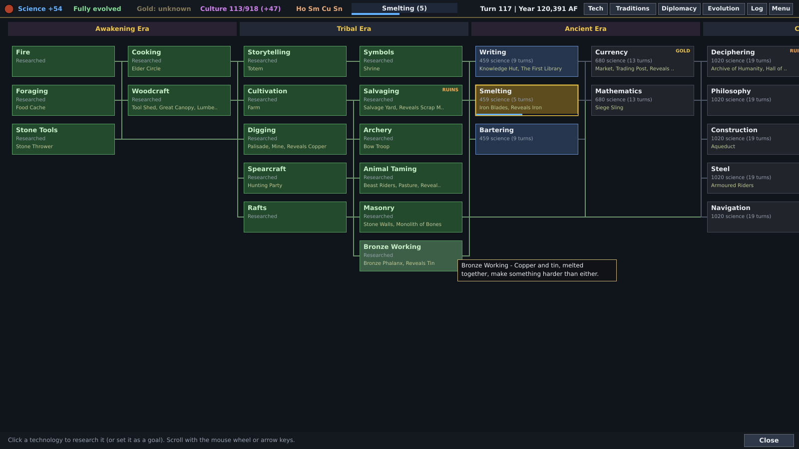 |
| 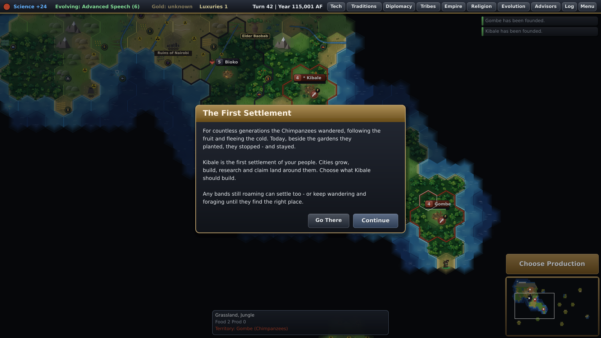 |  |
| 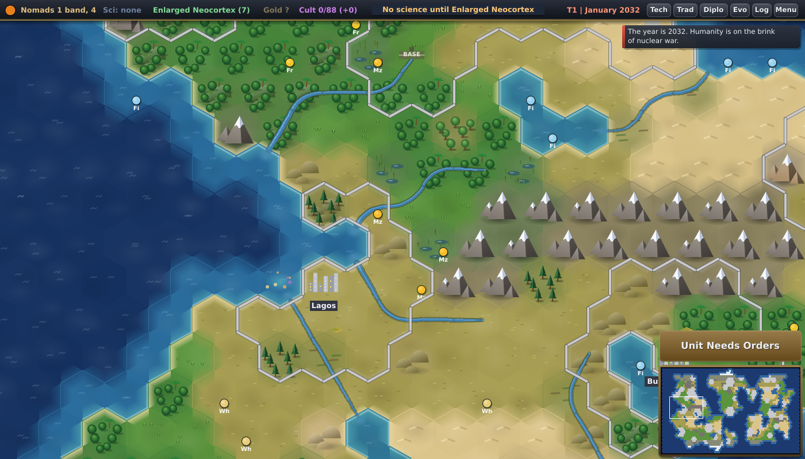 |  |
| 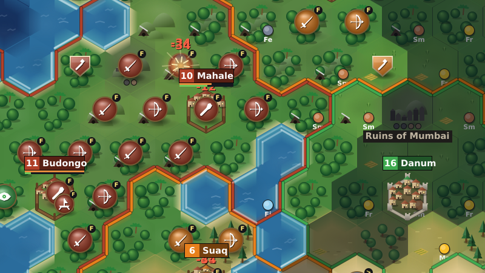 | 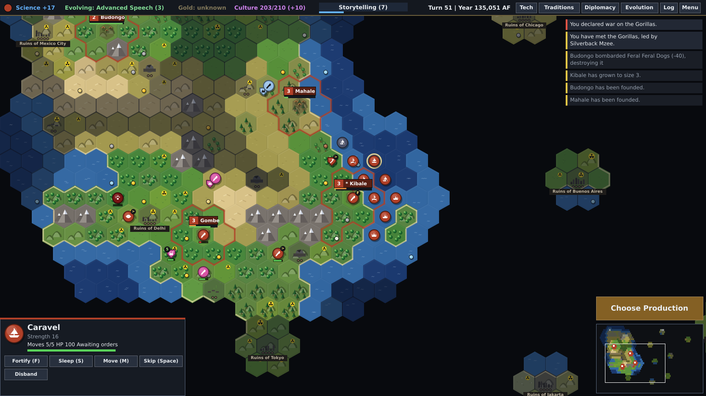 |
|  | 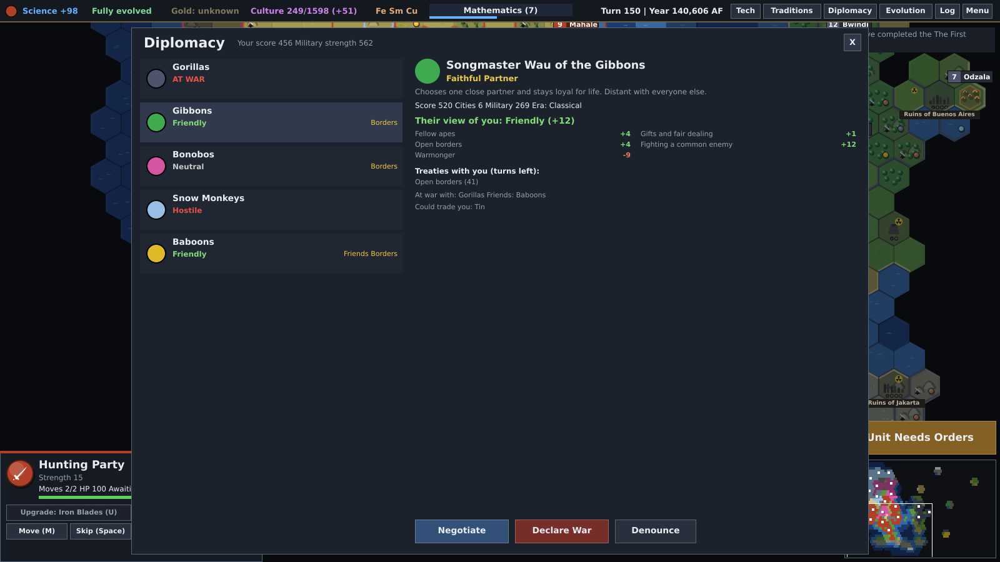 |
|  | 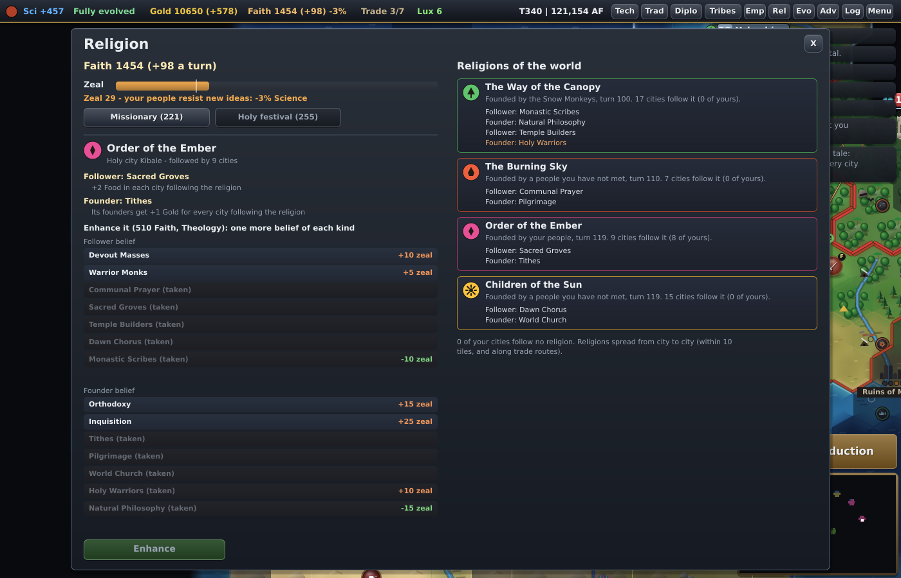 |
| 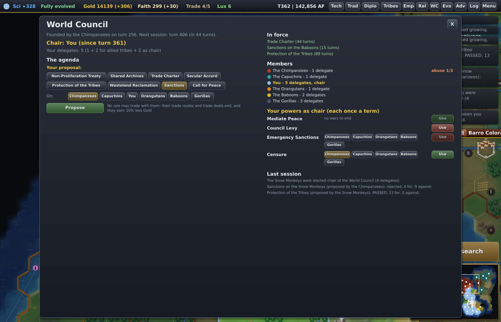 |  |
| 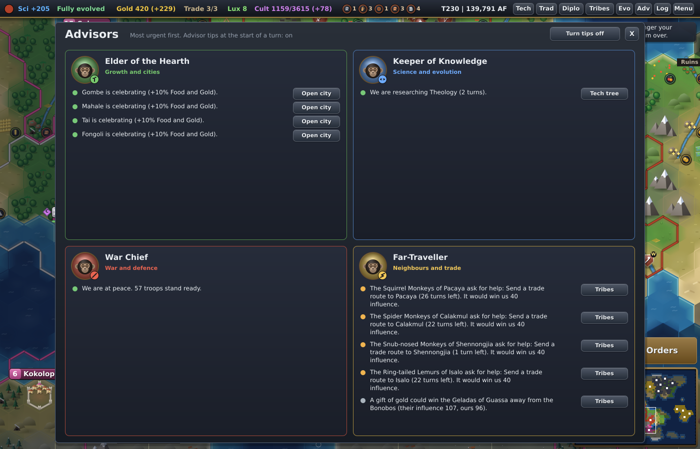 |  |
| 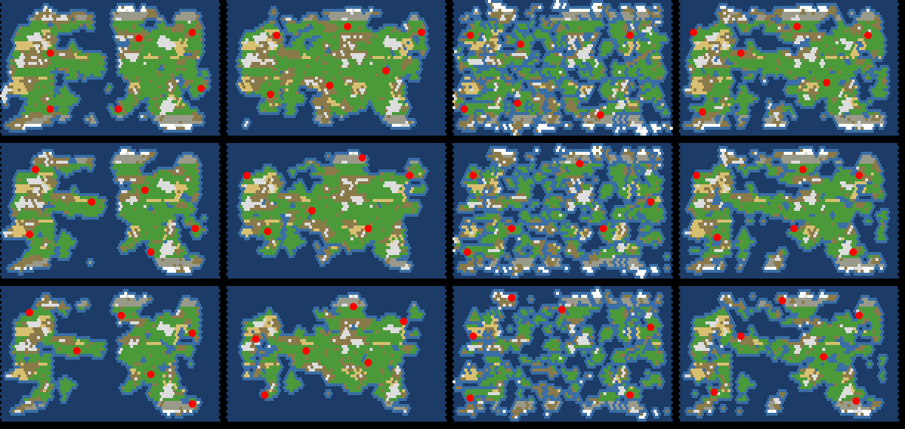 | 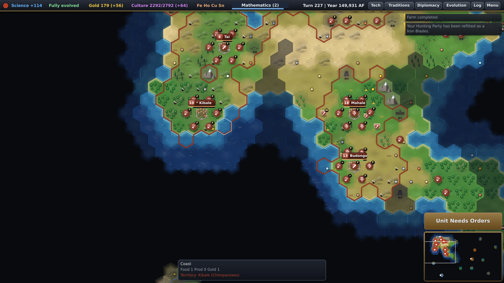 |

## Building from source

You need CMake 3.16 or newer and a C++17 compiler.

**Windows (Visual Studio 2019/2022):**

```bat
cmake -S . -B build -A x64
cmake --build build --config Release
build\Release\RebirthOfCivilisation.exe
```

**Windows (MSYS2 / MinGW-w64):**

```sh
cmake -S . -B build -G "MinGW Makefiles" -DCMAKE_BUILD_TYPE=Release
cmake --build build
```

**Tests (any OS):** the rules engine and interface are platform-independent, so the tests build everywhere:

```sh
cmake -S . -B build && cmake --build build
ctest --test-dir build            # complete AI-vs-AI games with rule checks
./build/rebirth_screens out/      # renders every screen to SVG
```

GitHub Actions builds the Windows executable and runs the tests on every push; pushes to `main` publish a release for the version in `CMakeLists.txt`.

## Project layout

```
src/core/        Rules engine (no platform code)
  Data.cpp         game data: primates, technologies, units, buildings, traditions
  Game.cpp         map, cities, units, movement, combat, research
  Turn.cpp         turn processing, the Fall, fallout, victory
  MapGen.cpp       world generation and start positions
  Bands.cpp        roaming bands, foraging and settling
  Rivers.cpp       rivers, lakes, terrain features, natural wonders
  Happiness.cpp    moods, luxuries, war weariness
  Trade.cpp        caravans, trade routes, roads
  Diplomacy.cpp    opinions, treaties and deals
  Tribes.cpp       minor tribes
  Religion.cpp     faith, religions, zeal
  Council.cpp      the World Council
  Great.cpp        Great Primates
  Promotions.cpp   experience and promotions
  Naval.cpp, Transport.cpp, Nukes.cpp, Disasters.cpp
  AI.cpp           computer opponents
  Achievements.cpp, Save.cpp
src/ui/          Interface, drawn through a small Canvas abstraction
src/audio/       Portable software mixer
src/platform/win32/   Windows window, input, GDI+ renderer and audio output
assets/audio/    Music, sound effects, ambience and primate calls
tests/           Simulation tests, screenshot renderer, stress test
```

Most balance changes only need `src/core/Data.cpp`.

## Contributing

Pull requests are welcome - balance, new primates, AI, graphics, sound and ports. Please run `ctest` before submitting. Ideas:

* Hand-drawn unit sprites
* Air units
* A Linux or macOS front end (only `src/platform/` needs a new backend)
* Network multiplayer

## Licence

The code is [MIT](LICENSE). Music and sounds in `assets/audio` keep their sources' licences - CC BY-SA 3.0 ([0 A.D.](https://play0ad.com/) by Wildfire Games), public domain ([FreePD.com](https://freepd.com/)), CC BY 4.0 and CC0 (primate recordings from Wikimedia Commons and Freesound) - see [CREDITS](assets/audio/CREDITS.txt). The stb_vorbis decoder is public domain. Please follow the [code of conduct](CODE_OF_CONDUCT.md); report security issues as described in [SECURITY.md](SECURITY.md).

## Code signing policy

Windows releases are built only by GitHub Actions from this repository. Free code signing provided by [SignPath.io](https://about.signpath.io), certificate by [SignPath Foundation](https://signpath.org). See the full [code signing policy](CODE_SIGNING_POLICY.md), including team roles and the privacy policy.
