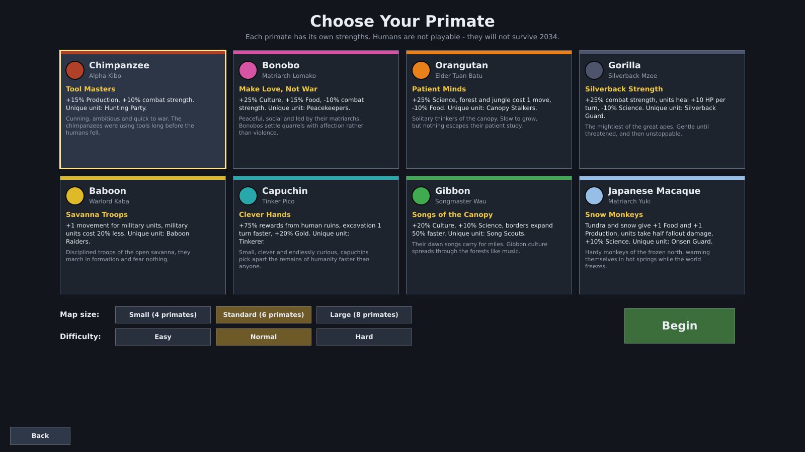
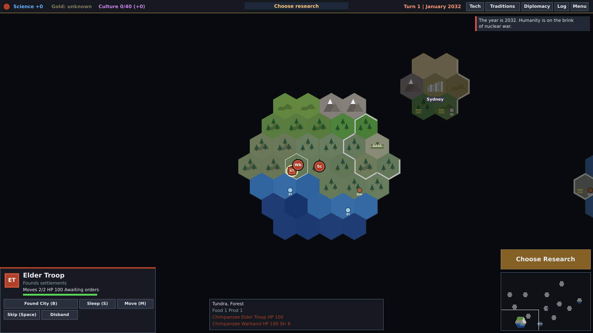
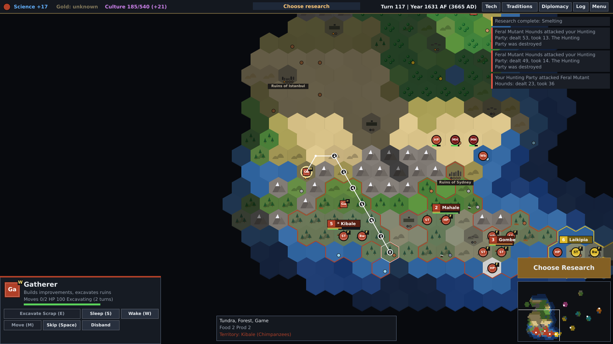

# Rebirth of Civilisation

**2034. Humanity destroys itself. The primates inherit the Earth.**

*Rebirth of Civilisation* is an open-source, turn-based 4X strategy game for Windows in the style of the classic *Civilization* games. It begins in 2032, shortly before humanity wipes itself out in a global nuclear war. Humans are not playable; you lead a band of **chimpanzees, bonobos, orangutans, gorillas, baboons, capuchins, gibbons or snow monkeys**. Survive the Fall, then rebuild civilisation from the ashes. In time, the ruins of the human world give up their secrets to primates advanced enough to understand them.


> This is an independent fan project inspired by the 4X genre. It is not affiliated with or endorsed by Firaxis Games, 2K or the *Civilization* franchise.

## Download and play

* **Download:** open the [Releases](../../releases) page and download `RebirthOfCivilisation-windows-x64.zip`. Every push also produces a build under **Actions → latest run → Artifacts**.
* **Install:** none. Unzip the file and run `RebirthOfCivilisation.exe`. It is one native Win32 program with no runtime dependencies, and it runs on Windows 7 through 11.
* **Saves:** stored in `%APPDATA%\RebirthOfCivilisation\savegame.roc`. The game also autosaves every 5 turns.

## The story

| Phase | What happens |
|---|---|
| **The last days (Jan 2032 – Aug 2034)** | Six turns of the prologue. Human cities still glow on the horizon and their radios grow more frightening each turn. Use the time to explore and found your first settlement, but keep your troop away from the human cities. |
| **The Fall (August 2034)** | A global nuclear war wipes out humanity completely. Every human city, town, military base, laboratory and power plant becomes a ruin surrounded by radioactive fallout. Units caught in the blasts die. |
| **The rebirth (Year 1 AF onward)** | Years are counted *After the Fall*. The primates develop from tool use and fire to writing, currency, industry, computing and finally the **Rebirth Project**. |


## Features

* **Hex map**, randomly generated, with grassland, plains, desert, tundra, snow, coast and ocean, plus forest, jungle, hills, mountains and resources. Small, Standard and Large sizes (4, 6 or 8 primate civilisations).
* **Eight playable primates**, each with its own bonuses, a unique unit and a preferred starting terrain (see below).
* **Turn-based economy** with Food, Production, Science and Culture. **Gold is not available at the start.** Your people only learn the value of money when they research **Currency**; from then on cities earn Gold, which buys units and buildings.
* **45 technologies across 9 eras** (Awakening, Tribal, Ancient, Classical, Kingdoms, Reclamation, Industrial, Modern, Rebirth), shown as a scrollable tech tree. You can click any technology to set it as a research goal.
* **Human ruins as a source of technology.** Every ruin holds up to four layers of salvage that unlock as you advance:

  | Layer | Unlocked by | Reward |
  |---|---|---|
  | Scrap | Salvaging | Science, plus Production for your nearest city |
  | Books | Deciphering | A large burst of Science |
  | Machines | Reverse Engineering | A free technology (cities), or Science and a restored war machine (military bases) |
  | Data Archives | Computing | A free technology plus Science |

  Ruins inside your borders also yield Production and Science, and the *Archive of Humanity* and *Salvage Yard* buildings boost them further.
* **Fallout** damages units and poisons tiles. It fades over time, and Gatherers can clean it up once you research Radiology.
* **Cities** grow, work tiles, expand their borders with culture, build 25 buildings and 6 world wonders, and bombard nearby enemies.
* **27 unit types:** Warbands and Stone Throwers early on, then Salvaged Rifles, Rebuilt Tanks and Exo-Primates. Ranged and siege units, embarkation across water, fortification, terrain defence bonuses and city capture all work as you would expect from the genre.
* **Traditions:** 16 culture-bought policies, similar to *Civilization V*'s social policies.
* **Feral packs:** feral dogs, then mutant hounds, then rogue human war machines roam the wastelands. They take the place of barbarians.
* **Diplomacy:** AI rivals declare war based on their personality and relative strength. You can declare war or sue for peace.
* **AI opponents** that expand, research, excavate ruins, wage war and race you to victory.
* **Four ways to win:**
  * **Rebirth (science):** research *Rebirth* and complete the *Rebirth Project*.
  * **Domination:** control every original primate capital.
  * **Cultural:** adopt all 16 Traditions.
  * **Score:** have the highest score when time runs out (turn 340).
* Save and load, autosave, an event log, tooltips everywhere, a minimap, and three difficulty levels.

## The primates

| Primate | Leader | Ability | Unique unit |
|---|---|---|---|
| Chimpanzee | Alpha Kibo | **Tool Masters:** +15% Production, +10% combat | Hunting Party (Spear Troop) |
| Bonobo | Matriarch Lomako | **Make Love, Not War:** +25% Culture, +15% Food, −10% combat | Peacekeepers (Bow Troop) |
| Orangutan | Elder Tuan Batu | **Patient Minds:** +25% Science, forest and jungle cost only 1 move, −10% Food | Canopy Stalkers (Crossbows) |
| Gorilla | Silverback Mzee | **Silverback Strength:** +25% combat, faster healing, −10% Science | Silverback Guard (Warband) |
| Baboon | Warlord Kaba | **Savanna Troops:** +1 move for military units, military units cost 20% less | Baboon Raiders (Beast Riders) |
| Capuchin | Tinker Pico | **Clever Hands:** +75% ruin rewards, faster excavation, +20% Gold | Tinkerer (Gatherer) |
| Gibbon | Songmaster Wau | **Songs of the Canopy:** +20% Culture, +10% Science, borders grow 50% faster | Song Scout (Scout) |
| Japanese Macaque | Matriarch Yuki | **Snow Monkeys:** tundra and snow give +1 Food and +1 Production, half fallout damage, +10% Science | Onsen Guard (Iron Blades) |



## Controls

| Input | Action |
|---|---|
| Left-click | Select a unit or city |
| Right-click | Move or attack with the selected unit (a path preview shows the number of turns) |
| Drag, or arrow keys | Scroll the map |
| Mouse wheel, or `+` / `-` | Zoom |
| `Enter` | End the turn |
| `Space` / `Tab` | Skip the unit / go to the next unit |
| `B` `F` `S` `E` `X` `M` | Found city / fortify / sleep / excavate ruins / decontaminate / move mode |
| `T` `P` `D` `L` | Technology tree / traditions / diplomacy / event log |
| `Ctrl+S` / `Ctrl+L` | Save / load |
| `F1` | How to play |
| `Esc` | Menu / close the current window |

## Screenshots

| | |
|---|---|
|  |  |
|  |  |
|  |  |

## Building from source

You need CMake 3.16 or newer and a C++17 compiler.

**Windows (Visual Studio 2019/2022):**

```bat
cmake -S . -B build -A x64
cmake --build build --config Release
build\Release\RebirthOfCivilisation.exe
```

**Windows (MSYS2 / MinGW-w64):**

```sh
cmake -S . -B build -G "MinGW Makefiles" -DCMAKE_BUILD_TYPE=Release
cmake --build build
```

**Tests (any OS, including Linux and macOS):** the rules engine and UI are platform-independent, so the test tools build everywhere:

```sh
cmake -S . -B build && cmake --build build
ctest --test-dir build            # plays complete AI-vs-AI games and checks game-rule invariants
./build/rebirth_screens out/      # renders every screen to SVG (convert to PNG with rsvg-convert)
```

GitHub Actions builds the Windows `.exe` and runs the tests on every push. Pushing a tag such as `v0.1.0` publishes a release with the zipped game.

## Project layout

```
src/core/        Rules engine - no platform code
  Data.cpp         all game data: primates, techs, units, buildings, ruins, traditions
  Game.cpp         tiles, cities, units, movement, combat, research, ruin excavation
  Turn.cpp         turn processing, the nuclear war, fallout, ferals, diplomacy, victory
  MapGen.cpp       world generation, human settlements, start positions
  AI.cpp           computer opponents
  Save.cpp         save games
src/ui/          User interface, drawn through the small Canvas interface
  GameUI.cpp       screens, panels, popups, input
  UIMap.cpp        hex map rendering
src/platform/win32/main_win32.cpp   Windows window, input and GDI renderer
tests/           AI simulation tests, screenshot renderer, random-input stress test
res/             Icon and Windows resources
```

Most balance changes only need edits to `src/core/Data.cpp`.

## Contributing

Pull requests are welcome, from balance tweaks and new primates to better AI, sound, graphics and ports. Run `ctest` before you submit. Some ideas for future work:

* Sound and music
* Proper unit artwork (sprites) instead of tokens
* Naval units and air units
* Trade routes, city-states made from surviving primate troops, and religion
* Multiplayer (hot-seat)
* A Linux and macOS front end (only `src/platform/` needs a new backend)

## Licence

[MIT](LICENSE)
